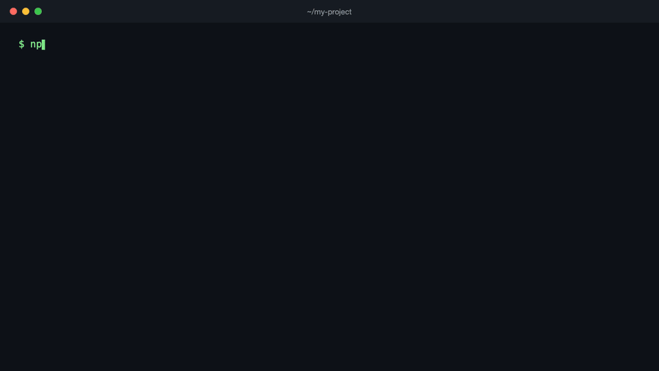

# spend-leash

Per-task budgets and a loop breaker for Claude Code: stop a task at $2 or 10% of your plan window, and pick up where it left off.

```sh
npx spend-leash init
```

[](https://github.com/codersanjay3/spend-leash/actions/workflows/ci.yml)
[](https://www.npmjs.com/package/spend-leash)
[](LICENSE)

**[Try the simulator in your browser](https://codersanjay3.github.io/spend-leash/)**: replay a session through the real enforcement code and see when it would warn or stop. Nothing leaves your browser.

## What it does

- **Budget per task.** Every prompt starts a task with a limit in dollars, in percent of your 5-hour plan window, or both. Default: $2. At 80% Claude is told to wrap up. At 100% the task is stopped.
- **Loop breaker.** The same tool call repeated, or the same failing command, gets a warning at the third try and a stop at the fifth. Editing a file resets the count, so read, edit, read and run tests, fix, run tests are not loops.
- **Plan-window guard.** When your 5-hour plan window passes 95%, spend-leash writes a handoff and stops cleanly instead of letting the hard usage limit cut a turn in half.
- **Handoff and resume.** Every stop writes a markdown file with what you asked for, where Claude got to, the last tool calls and the git state. The next session in that project is told the file exists.

## How it works

`npx spend-leash init` copies two dependency-free files to `~/.spend-leash/` and adds hooks to your Claude Code settings. Nothing else is installed.

**Hooks** (one command each, `node ~/.spend-leash/hook.mjs <event>`):

| Event | What spend-leash does |
| --- | --- |
| `UserPromptSubmit` | Starts a task, reads a `#budget` directive if there is one. |
| `PreToolUse` | Checks spend, plan window and loop. Warns, or denies the call and stops. |
| `PostToolBatch` | Same check, so a batch that crossed the limit stops before the next model call. |
| `PostToolUse`, `PostToolUseFailure` | Feeds the loop breaker (a failure adds to the count for that call). |
| `Stop` | Records the task in the ledger. Never blocks. |
| `StopFailure` | Writes a handoff and records the task. |
| `SubagentStop` | No decision. |
| `SessionStart` | If an unread handoff exists for this project (newest within 7 days), shows Claude the first 1,500 characters and marks it read. |

**Spend comes from the transcript.** No hook input carries cost, so spend-leash reads the session transcript Claude Code already writes, plus every file in its `subagents/` folder, counts each API message once, and prices the tokens with a built-in table. Each hook call reads only the bytes added since the last one. An unknown model is priced as the most expensive known one and flagged as estimated.

**Plan % comes from the status line.** Only the status line is given your 5-hour usage. `init` wraps your existing `statusLine` command: the wrapper saves a snapshot, then runs your original command with the same input and prints its output unchanged (2 second limit). With no status line of your own, it prints `spend-leash · 5h 37% · task limit $2.00`. Snapshots older than 10 minutes are ignored.

**Subagents count.** Every check uses the whole session's spend, so a subagent that pushes the task over the limit stops the parent on its next tool call too.

## `#budget` directives

Start a prompt with `#budget` to change that task's limits. The directive is left in the prompt; Claude seeing it is harmless.

| Directive | Effect |
| --- | --- |
| `#budget $5` | This task may spend $5. |
| `#budget 15%` | This task may use 15% of the 5-hour plan window. |
| `#budget $5 20%` | Both limits; whichever is hit first stops the task. |
| `#budget +$3` | Continue the stopped task with $3 more. The baseline is not reset. |
| `#budget off` | No budget for this task. The loop breaker stays on. |
| `#budget new` | Start a fresh task with the default budget, even right after a stop. |
| `#budget plan-off` | Turn the plan-window guard off for the rest of the session. |

Example: `#budget $5 refactor the auth module to use sessions`

**After a budget stop, a plain prompt continues the same task.** If you reply "continue" without a directive, the task keeps its old baseline and limit, so the next tool call stops again. This is deliberate: a budget you can walk past by typing "go on" is not a budget. Use `#budget +$2` to give it more, or `#budget new` to start over. After a loop stop the task also continues, with the loop history cleared. The plan guard stops at most once per 5-hour window per session; later prompts in that window run with a one-line warning.

## Config reference

`~/.spend-leash/config.json` is created by `init` with these defaults. Set `SPEND_LEASH_HOME` to move the whole `~/.spend-leash` directory.

```json
{
  "task": { "usd": 2, "planPct": null, "warnAt": 0.8 },
  "plan": { "stopAtPct": 95 },
  "loop": { "warnAt": 3, "stopAt": 5, "window": 12, "ignoreTools": [] },
  "handoff": { "dir": ".spend-leash/handoffs" },
  "failClosed": false
}
```

| Key | Default | Meaning |
| --- | --- | --- |
| `task.usd` | `2` | Default dollar limit per task. `null` for none. |
| `task.planPct` | `null` | Default limit as percent of the 5-hour window, measured as the increase since the task started. |
| `task.warnAt` | `0.8` | Fraction of the limit at which Claude is told to wrap up. |
| `plan.stopAtPct` | `95` | Stop when the 5-hour window reaches this percent. |
| `loop.warnAt` | `3` | Warn when one call (or failure) shows up this many times in the window. |
| `loop.stopAt` | `5` | Stop at this many. |
| `loop.window` | `12` | How many recent tool calls to look at. |
| `loop.ignoreTools` | `[]` | Tools the loop breaker skips. `TodoWrite` and the task-list tools are always skipped. |
| `handoff.dir` | `.spend-leash/handoffs` | Where handoffs go, relative to the project. Falls back to `~/.spend-leash/handoffs` if the project is not writable. |
| `failClosed` | `false` | On an internal error in a budget check, deny the call instead of letting it through. |
| `prices` | built-in table | Optional per-model overrides, keyed by model-id prefix, with `input`, `output`, `cacheWrite5m`, `cacheWrite1h`, `cacheRead` in USD per million tokens. |

Invalid or unknown keys are ignored and the default is kept. `init` prints a note for each one.

**A project file can only tighten.** `<project>/.spend-leash.json` takes the same keys, but a cloned repo cannot loosen your limits. Lower budgets and thresholds are applied, a higher or looser value is ignored with a note, and the project cannot change `prices`, `handoff.dir` or `loop.ignoreTools`.

## Commands

```sh
npx spend-leash init [--scope user|project|local] [--budget 2|10%] [-y]
npx spend-leash uninstall [-y]
npx spend-leash status
npx spend-leash report [-n 20] [--today] [--json]
```

- `init` shows what it will change, asks, backs up the settings file, and writes atomically. `--scope` picks which settings file gets the hooks (default `user`, `~/.claude/settings.json`). `--budget` sets the default task limit: `2` or `$2` for dollars (quote the `$` in your shell), `10%` for plan percent. `-y` skips the question. Running it twice changes nothing.
- `uninstall` removes exactly what `init` recorded and puts your original `statusLine` back. If you changed your status line since, yours is left alone and you get a note.
- `status` shows each recent session's task: spend against limit, last known 5-hour percent, outcome, and whether plan data is available. Running `npx spend-leash` with no command does the same.
- `report` lists recent tasks from the ledger with time, outcome, dollars and prompt. `-n` sets how many (default 20), `--today` limits to today, `--json` prints machine-readable output.

## What it cannot do

- **It cannot stop Claude mid-generation.** Enforcement happens at tool calls and turn boundaries. A long reply with no tool calls is not interrupted, so a task can finish a little over its limit.
- **USD is an estimate.** It is computed from token counts at list price, like Claude Code's own `/usage`. It is not your bill. Prices are in `src/pricing.ts` and can be overridden in `config.json`.
- **Plan % needs plan data.** Only the status line sees your 5-hour usage, and only on a Pro, Max or Ultra plan after the first response. With an API key, in `claude -p`, or before the first reply, plan-% budgets and the plan guard are inactive and spend-leash says so. A dollar budget still applies.
- **Claude Code only.** No Codex CLI or Gemini CLI support yet.
- **Hooks fail open.** On an internal error or after about 1.5 seconds, a hook exits quietly and the call goes ahead, and one line goes to `~/.spend-leash/errors.log`. Set `failClosed` if you would rather block.
- **Transcripts can lag.** Spend is only as current as the transcript file Claude Code has written.

## Compared with

- **[ccusage](https://github.com/ryoppippi/ccusage)** reports what you have spent: daily, monthly and per-session dashboards from the same transcripts. spend-leash does not try to be a dashboard; it acts while a task runs. They work together.
- **`claude --max-budget-usd` and `--max-turns`** are options for print mode (`claude -p`). spend-leash covers interactive sessions, per task rather than per run.
- **Claude Code's own auto-continue** can carry on after a usage limit. spend-leash stops earlier and by your rules, and leaves a handoff file; it does not resume anything by itself.

## Uninstall

```sh
npx spend-leash uninstall
```

This removes the hooks, restores your original `statusLine` byte for byte when nothing else changed, and deletes the two copied files. Your ledger, handoffs and config stay in `~/.spend-leash`; delete that folder to remove them. Settings backups (`settings.json.bak-<timestamp>`) are kept next to your settings file.

## Privacy

No network calls and no telemetry. spend-leash only reads files on your machine and writes these:

| Path | Holds | Mode |
| --- | --- | --- |
| `~/.claude/settings.json` (or the scope you chose) | the hooks and status line, with a `.bak-<timestamp>` backup | unchanged |
| `~/.spend-leash/hook.mjs`, `statusline.mjs`, `config.json`, `install.json`, `statusline.json` | the installed code, your config and what `init` changed | default |
| `~/.spend-leash/tasks.jsonl` | one line per task: prompt (first 200 characters, redacted), cost, tokens, outcome | `0600` |
| `~/.spend-leash/sessions/*.json` | per-session task state and statusline snapshots | `0600` |
| `~/.spend-leash/errors.log` | one line per swallowed error | `0600` |
| `<project>/.spend-leash/handoffs/*.md` | handoff files | `0600` (directory `0700`) |

Modes apply on POSIX. Secrets in prompts and tool arguments are redacted by key name and by common token shapes, but redaction is not perfect. Add `.spend-leash/` to your `.gitignore` before handoff files end up in a commit.

## Sibling project

[mcp-leash](https://github.com/codersanjay3/mcp-leash) finds the dangerous tools in your MCP servers and locks them down in Claude Code.

## Contributing

See [CONTRIBUTING.md](CONTRIBUTING.md). Security issues: [SECURITY.md](SECURITY.md).

## License

[MIT](LICENSE)
